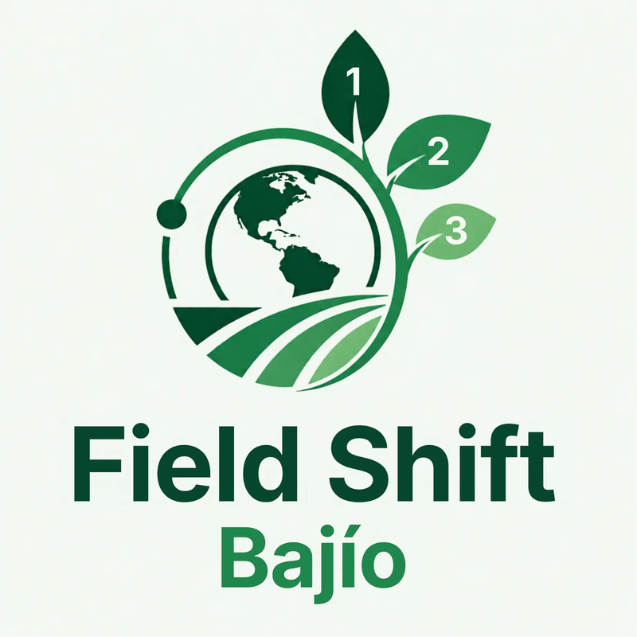

<p align="center"></p>

# Field Shift Bajío

Proyecto del **NASA Space Apps Challenge 2026**, sede Querétaro. Reto: *Field Shift: Adapting Farms with NASA Data*.

Una herramienta para el agricultor de **temporal** del Bajío (Guanajuato y Querétaro): dibuja el contorno de tu parcela en el mapa, di qué te importa más, y te propone una rotación de cultivos de 3 años que cuida el suelo y aguanta el clima. El riesgo se calcula con los **años secos reales** de tu parcela (25 años de datos de la NASA), no con un promedio.

> Versión en español para el equipo. La versión de entrega, en inglés, es [README.md](README.md).

## Estado

**Integrado de punta a punta:** dibujas la parcela, eliges temporal o riego y tu prioridad, y recibes la rotación de 3 años con sus razones, la maqueta 3D y el asistente.

| Fase | Qué incluye | Estado |
|------|-------------|--------|
| F1 | Esqueleto, `/api/clima`, `/api/suelo`, caché y respaldo sin internet | Lista |
| F2 | `cultivos.json`, motor de reglas con pruebas, `/api/recomendar`, mapa y formulario | Lista (rangos de los cultivos verificados contra FAO; falta el agua del garbanzo y del brócoli) |
| F3 | Integración de punta a punta con una parcela real | Lista en la rama de integración; falta ensayarla en la laptop de la demo |
| F4 | Explicaciones, gráfica, errores y estados de carga | Parcial |
| F5 | README en inglés con capturas y créditos completos | Pendiente |

**Pendientes conocidos**

- Confirmar el agua por ciclo del garbanzo y del brócoli en `server/data/cultivos.json` (no están en la tabla 14 de FAO; quedan con `"verificado": false`).
- La voz (micrófono) no se ha probado con un micrófono real.

## Cómo correrlo

Necesitas **Node.js 20 o más nuevo** (probado con Node 24). No hace falta ninguna API key ni base de datos.

Para publicarla (Vercel para la página, Render para el API, o un túnel de Cloudflare para la demo en vivo), mira [docs/despliegue.md](docs/despliegue.md).

Se usan dos terminales. En la primera, el servidor (puerto 3001):

```bash
cd server
npm install
npm run dev
```

En la segunda, la interfaz (puerto 5173):

```bash
cd client
npm install
npm run dev
```

Abre <http://localhost:5173> y presiona **Celaya, Gto. (Temporal)**. Debes ver la lluvia de junio a septiembre, los años secos y el pH del suelo. En "2. Simulador 3D" sale la rotación de 3 años.

El asistente responde mejor con [Ollama](https://ollama.com/) abierto y el modelo `gemma3:4b` descargado; sin Ollama contesta con una plantilla. Detalle en [docs/probar-asistente.md](docs/probar-asistente.md).

### Pruebas

```bash
cd server
npm test
```

```bash
cd client
npm test
```

Las pruebas no usan internet: leen los fixtures.

### Demo sin internet

Las tres parcelas de ejemplo (Celaya, El Marqués y Salamanca) y tres más del Bajío tienen sus respuestas reales de clima, suelo y relieve guardadas en `server/fixtures/`, así que funcionan aunque falle la red. Sin internet no hay imagen de satélite, pronóstico ni búsqueda de direcciones. Para ensayar sin internet, arranca el servidor con `OFFLINE=1`:

```bash
OFFLINE=1 npm run dev
```

En PowerShell:

```powershell
$env:OFFLINE = "1"; npm run dev
```

Cualquier punto que ya se consultó una vez queda en `server/cache/` y también funciona sin internet. Para volver a bajar los fixtures: `npm run fixtures` (dentro de `server/`). La lista de parcelas está en `server/lib/seasons.js`.

Para la demo conviene `npm start` en lugar de `npm run dev`: no reinicia el servidor cuando cambia un archivo.

## API

| Ruta | Qué responde |
|------|--------------|
| `GET /api/ejemplos` | Las parcelas de los botones de ejemplo (todas con respaldo sin internet). |
| `GET /api/clima?lat&lon` | Lluvia de junio a septiembre por año, años secos, y temperatura y lluvia promedio por mes. |
| `GET /api/suelo?lat&lon` | pH, arcilla, arena, limo, carbono orgánico y nitrógeno de 0 a 30 cm. |
| `POST /api/recomendar` | Cultivos con puntaje, riesgo (con su rango) y razones; la rotación de 3 años; y la comparación de 3 rotaciones (la de hoy, la recomendada y otra meta) con evidencia, beneficios, huecos, qué revisar con un técnico y lo que los datos no saben (motor de reglas). |
| `GET /api/recomendar/prueba?lat&lon` | Cada cultivo de temporal contra los años reales: lluvia de su ciclo por año y si le alcanzó, sembrando en junio y en julio. |
| `GET /api/pronostico?lat&lon` | Pronóstico de 7 días. |
| `POST /api/asistente` | Respuesta del asistente con los datos de la parcela. "¿Qué siembro?" usa el mismo motor que `/api/recomendar`. |
| `POST /api/voz` | Voz a texto (Whisper local). |

Las formas exactas de cada respuesta, con ejemplos reales, están en [docs/api-contract.md](docs/api-contract.md).

## Estructura

```
server/
  index.js, app.js     arranque y rutas
  routes/              clima, suelo, recomendar, asistente, pronostico, voz
  sources/             NASA POWER, SoilGrids y Open-Meteo: descarga y normalización
  lib/                 coordenadas, caché en disco, fetch con timeout, temporadas y parcelas de ejemplo
  engine/              motor de reglas: puntaje, riesgo por años secos y rotación (funciones puras)
  llm/                 asistente: ficha de la parcela, modelo local (Ollama), verificador, datos del SIAP
  data/                cultivos.json (7 cultivos, verificados contra FAO salvo el agua de garbanzo y brócoli) y siap_resumen.json
  fixtures/            respuestas reales de 6 parcelas (respaldo sin internet)
  cache/               caché en disco, no se versiona
  scripts/             fetch-fixtures.js, siap-descargar.js
  test/                pruebas
client/
  src/pages/           las 4 pantallas: Parcela, Simulador 3D (rotación), Análisis IA y Probar cultivo
  src/components/      cabecera, buscador de ubicación, gráficas (Chart.js), asistente flotante
  src/hooks/           useParcela: el estado que comparten las pantallas
  src/config/          capas de NASA GIBS del mapa y parcela por defecto
  src/map/             mapa MapLibre donde se dibuja la parcela, y cálculos del polígono
  src/three/           modelos 3D de los cultivos que se dibujan sobre el mapa (three.js)
  public/models/       un .glb por cultivo, generado con Blender (no se edita a mano)
assets/blender/        build_models.py: script que genera los modelos 3D
docs/
  api-contract.md      contrato entre front, back y motor
```

### Vista 3D

En "Parcela" y en "Simulador 3D" el mapa de satélite se inclina con el **relieve real** (AWS Terrain Tiles, alturas de NASA SRTM) y cada parcela guardada se levanta como un bloque:

- los lados del bloque llevan el **color del suelo** según SoilGrids, y abajo una tarjeta "Tu suelo" con el tipo de suelo, cada capa y la humedad de NASA POWER,
- encima se paran los **modelos 3D del cultivo** (capa propia de MapLibre con three.js); en "Simulador 3D" es el cultivo del año elegido en el plan,
- un control de **años desde 2000 hasta el último año completo**: en años secos las plantas se ven chaparras y color paja.

Si el navegador no puede con el 3D, el mapa sigue funcionando en 2D.

**Modelos 3D.** Salen de [assets/blender/build_models.py](assets/blender/build_models.py). Para cambiarlos, edita el script y vuelve a generar `client/public/models/bajio.glb` (Blender 4.2 o más nuevo):

```bash
blender --background --factory-startup --python assets/blender/build_models.py
```

**Texturas.** Cada parte tiene un material procedural (nervaduras en hojas, fibras en tallos, granos en espigas y elote, floretes en el brócoli, corteza, aplanado de adobe, tejas y vetas de madera) que Blender hornea en **una sola imagen por modelo** (JPEG dentro de cada `.glb`). Así cada cultivo sigue siendo un solo dibujo aunque tenga cientos de plantas.

**22 cultivos, un archivo por cultivo.** Maíz, sorgo, trigo, cebada, frijol, garbanzo, brócoli, avena, amaranto, girasol, cacahuate, calabaza, papa, cebolla, jitomate, chile, fresa, arroz, alfalfa, agave, nopal y aguacate. Cada uno vive en `client/public/models/<id>.glb` (117 a 355 KB) y la app solo descarga los que el agricultor usa; `escenario.glb` trae la casa y el mezquite. Los 7 primeros son los del motor de reglas; los otros 15 son, por ahora, solo para verlos en el mapa y la maqueta.

**Dos versiones de cada cultivo.** La maqueta 3D usa modelos **detallados** (el maíz tiene hojas anchas que se arquean con su nervadura, tallo con nudos y vainas, elote con hojas y pelos, espiga ramificada y raíces de apoyo; 1,400 a 3,300 triángulos). El mapa satelital usa los detallados cuando está cerca (zoom 16.2 o más, con la mitad de matas) y los **sencillos** (`<id>_lp`) de lejos, donde cada mata mide pocos píxeles. El terreno de la maqueta (surcos, terrones, capas del suelo) y los bloques del mapa (hileras sembradas y terrones) usan texturas que el navegador dibuja al momento (`client/src/three/textures.js`, `client/src/map/patterns.js`). Ninguna textura se descarga de internet.

Si alguien modela a mano en Blender, el `.glb` debe conservar los nombres de objeto: `maiz`, `sorgo`, `trigo`, `cebada`, `frijol`, `garbanzo`, `brocoli`, `casa`, `arbol`.

## Credits

**Datos**

- **NASA POWER** (Prediction Of Worldwide Energy Resources), NASA Langley Research Center. Serie mensual desde 2000 hasta el último año completo, comunidad AG: temperatura, precipitación, radiación y humedad del suelo en superficie, zona de raíces y perfil (GWETTOP, GWETROOT, GWETPROF). <https://power.larc.nasa.gov/>
  *These data were obtained from the NASA Langley Research Center (LaRC) POWER Project funded through the NASA Earth Science/Applied Science Program.*
- **SoilGrids 2.0**, ISRIC World Soil Information, licencia CC BY 4.0. Propiedades del suelo de 0 a 100 cm (textura, pH, carbono orgánico, nitrógeno, densidad aparente, CIC y piedras) y tipo de suelo (clasificación WRB). <https://soilgrids.org/>
  IUSS Working Group WRB (2015). *World Reference Base for Soil Resources 2014, update 2015*. World Soil Resources Reports No. 106. FAO, Roma. (Nombres y descripciones generales de los tipos de suelo.)
  Poggio, L., de Sousa, L. M., Batjes, N. H., Heuvelink, G. B. M., Kempen, B., Ribeiro, E., and Rossiter, D. (2021). SoilGrids 2.0: producing soil information for the globe with quantified spatial uncertainty. *SOIL*, 7, 217–240. <https://doi.org/10.5194/soil-7-217-2021>
- **INEGI, Censo Agropecuario 2022**: en Guanajuato el 63.9 % de la superficie agrícola es de temporal.
- **INEGI, Marco Geoestadístico** (diciembre de 2025), límites de Guanajuato y Querétaro (`server/data/estados_bajio.json`, de <https://gaia.inegi.org.mx/wscatgeo/v2/geo/mgee/11> y `/22`): deciden si una parcela está en el Bajío, donde se recomiendan cultivos.
- **NASA GIBS** (Global Imagery Browse Services). <https://www.earthdata.nasa.gov/gibs>
  - Capas que el agricultor puede prender sobre el mapa (solo visuales, imagen del 12 de agosto de 2024): **MODIS Terra, color real** (`MODIS_Terra_CorrectedReflectance_TrueColor`), **MODIS Terra NDVI de 16 días** (`MODIS_Terra_L3_NDVI_16Day`) y **SMAP, humedad en la zona de raíces** (`SMAP_L4_Analyzed_Root_Zone_Soil_Moisture`).
  *We acknowledge the use of imagery provided by services from NASA's Global Imagery Browse Services (GIBS), part of NASA's Earth Science Data and Information System (ESDIS).*
- **Terrain Tiles** en el Registry of Open Data on AWS (formato *terrarium* de Mapzen), relieve 3D del mapa. En México las alturas provienen de **NASA SRTM** (Shuttle Radar Topography Mission). <https://registry.opendata.aws/terrain-tiles/>

- **Esri World Imagery** y **World Imagery (Clarity)**, la versión sin nubes, más **World Boundaries and Places** y **World Transportation** (imagen satelital, nombres de lugares y calles del mapa donde se dibuja la parcela; el agricultor elige "Sin nubes" o "Más rápida"). *Imágenes: Esri, Maxar, Earthstar Geographics y la comunidad de usuarios GIS.* Se usan sin API key para este prototipo; para un uso en producción hay que revisar los términos de Esri.
  - "Detectar con un toque" lee esas mismas imágenes y la capa de calles para proponer el contorno de la parcela (visión por computadora clásica en el navegador, sin modelo entrenado).

- **SIAP** (Servicio de Información Agroalimentaria y Pesquera), *Cierre de la producción agrícola* 2018–2024, datos abiertos, agregado por estado: superficie, pérdidas, rendimiento y precio medio rural de Guanajuato y Querétaro. Se usa para el ingreso bruto por hectárea de la prioridad "ganar más" y en el asistente. <https://nube.agricultura.gob.mx/>
- **Open-Meteo**, pronóstico de 7 días (CC BY 4.0). <https://open-meteo.com/>
- **OpenStreetMap / Nominatim**, búsqueda de pueblos y direcciones. © colaboradores de OpenStreetMap (ODbL).
- **Wikipedia en español** (CC BY-SA), textos de apoyo del asistente para preguntas generales; cada respuesta enlaza su página.
- **Requerimientos de los cultivos** (`server/data/cultivos.json`), verificados el 15 de noviembre de 2026:
  - **FAO Ecocrop**, fichas oficiales de cada especie (temperatura y pH óptimos; también se guardan los rangos absolutos, la lluvia anual y el ciclo). <https://ecocrop.apps.fao.org/>
  - **FAO**, Brouwer, C. y Heibloem, M. (1986). *Irrigation Water Management: Training Manual No. 3, Irrigation Water Needs*, tabla 14 (agua que necesita el cultivo en todo su ciclo). <https://www.fao.org/4/s2022e/s2022e07.htm>
  - Ecocrop da la lluvia **anual**, no la del ciclo; por eso el agua por ciclo sale de la tabla 14. Garbanzo y brócoli no están en esa tabla: su agua sigue aproximada (`"verificado": false`).
  - Son rangos generales de cada especie, no de las variedades que se siembran en el Bajío. El ciclo en meses es el típico del Bajío.

**Software**

React, Vite, react-router, Express, MapLibre GL JS, three.js, Chart.js, Bootstrap y Bootstrap Icons, todos de código abierto. Tipografías Plus Jakarta Sans y JetBrains Mono vía Google Fonts. Modelos 3D hechos por el equipo con Blender (script en `assets/blender/`).

El diseño de las pantallas (HTML, CSS y textos) lo aportó el equipo como maqueta estática y se portó a React conservando su estructura. "Probar cultivo" usa el mismo motor de reglas que el Simulador 3D (`/api/recomendar`); los rangos de sus 7 cultivos están en `server/data/cultivos.json` y salen de la FAO (falta el agua del garbanzo y del brócoli).

**Uso de inteligencia artificial**

- Este proyecto se desarrolla con ayuda de **Claude Code** (Anthropic) para escribir y revisar código. Todo el código se escribió durante el evento y el equipo lo revisa por pull request.
- Dentro de la app, el asistente redacta sus respuestas con **Gemma 3** (Google), que corre en la misma laptop con **Ollama**, y solo con los datos de la parcela; los números los pone el código y un verificador los revisa. La recomendación de cultivos no la hace un modelo de IA: la calcula el motor de reglas.
- La voz a texto usa **Whisper** (OpenAI, modelo `whisper-base`) con transformers.js, también local.

## Licencia

MIT. Ver [LICENSE](LICENSE).
