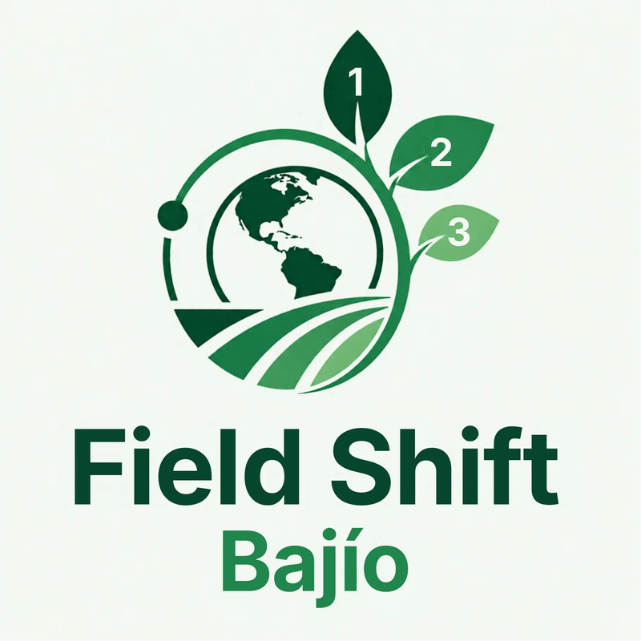

<p align="center"></p>

# Field Shift Bajío

**Crop rotations for rain-fed farmers in central Mexico, measured against the real dry years of their own plot.**

NASA Space Apps Challenge 2026 · Querétaro local event · Challenge: *Field Shift: Adapting Farms with NASA Data*.

> Versión en español para el equipo: [README.es.md](README.es.md). The app itself speaks Spanish, the language of the farmers it is for.

## The problem

In the Bajío region (the states of Guanajuato and Querétaro) most farmland depends on rain alone: **63.9 % of the farmed
area of Guanajuato is rain-fed** (*temporal*, INEGI Agricultural Census 2022). Farmers there mostly sow maize year after
year. Maize is 58 % of the rain-fed summer area in Guanajuato and 91 % in Querétaro (SIAP 2018–2024). When the summer
rain fails, the crop fails. Repeating the same crop also wears down the soil and builds up pests.

Advice usually comes from averages. But a farmer does not lose a harvest to the average year; they lose it to the dry ones.

## What it does

Field Shift Bajío is a decision-support tool that compares crop rotations for one specific plot. It uses NASA Earth
observations, the plot's soil, crop requirements and what the farmer cares about most.

1. **Draw your plot.** On a satellite map, the farmer taps the corners of the field (or walks them with GPS, or taps
   once inside it and the app proposes the outline). The plot then appears as a block in 3D relief. Cards open one at a
   time and the map changes with each one:
   - the weather right now;
   - 26 years of rain (NASA POWER, 2000–2025), with the dry years;
   - the soil (SoilGrids);
   - vegetation greenness (MODIS NDVI) and root-zone soil moisture (SMAP) from NASA GIBS.

   The last card asks a few plain questions: rain-fed or irrigated, what matters most (earn more, care for the soil,
   use less water, risk less), what they sowed last and what is in the ground now.
2. **Compare 3 rotations** ("2. Simulador 3D"). The challenge asks for at least three rotation strategies, including the
   existing one:
   - **Keep doing what you do today.** Taken from the farmer's answers. If they gave none, the app uses the most sown
     crop of their state (SIAP) and labels it as an assumption.
   - **The best rotation for the farmer's goal.**
   - **The best rotation for another goal** that gives a different plan.

   The three are shown side by side for each measure:
   - seasons without enough rain, with an uncertainty range;
   - seasons with a legume;
   - times a crop family repeats in a row;
   - water the crops need;
   - gross income per hectare.

   For each rotation the app explains why it was suggested, what evidence supports it, its benefits against today's
   rotation, where the information gaps are, and what a local agronomist should review. Picking a rotation and a year
   shows that crop growing on the farmer's own plot in the map. Moving through the 26 real years shows whether the
   rain of each year would have been enough for it.
3. **Ask the assistant** ("3. Análisis IA"), by text or by voice. "What should I sow?" is answered by the same rule
   engine, with the same three rotations and the same numbers as the screen.
4. **Try a crop** ("4. Probar cultivo"): any crop against the plot's 26 real years, sown in June or July.

Every number on screen comes from data and says where it came from. A card called "What we don't know" lists the
limits of the data. The tool helps the farmer compare; it does not replace their judgment or a local agronomist, and
it says so.

## How it works

```
Plot outline (MapLibre) -> center point -> NASA POWER (monthly 2000-2025)  ┐
                                          SoilGrids (0-30 cm)             ├-> rule engine -> 3 rotations
                                          SIAP (state yields and prices)  ┘   (server/engine)   + reasons
                                                                                                 + uncertainty
```

- **Risk is counted, not averaged.** For each crop and sowing month (June or July), the engine adds up the rain of the
  crop's own cycle months in each of the 26 real years. A year fails when that rain was below the crop's minimum. A
  risk of "12 of 26 years" is the count of those years.
- **Scores** combine how well the crop fits the plot (temperature in range, rain in range, soil pH) with the farmer's
  goal: income (SIAP), soil (legumes and diversity), water (lower need) or risk (fewer failed years).
- **Rotation rules:**
  - never the same crop family in back-to-back seasons;
  - at least one legume in 3 years;
  - autumn-winter crops only with irrigation;
  - the first year does not repeat the family of the crop in the ground now.
- **Uncertainty is part of the answer:**
  - **Few years.** With 26 years, "12 of 26" is shown with its 90 % Wilson interval (31 % to 62 %).
  - **General crop requirements.** The ranges are FAO's for each species, not for local varieties. The app shows how
    much the result moves if a crop needed 10 % less or more rain: 8 to 15 years instead of 12 for maize in Celaya.
- **The assistant** is not a second recommender. Recommendations come from the same engine. A local language model
  (Gemma 3 through Ollama) only words some answers, and a checker verifies that every number it writes comes from the
  plot's data.

## Use of NASA data

| NASA data | How it is used |
|---|---|
| **NASA POWER**, monthly point data from 2000 to the last complete year (the demo fixtures stop at 2024), community AG: `T2M`, `T2M_MAX`, `T2M_MIN`, `PRECTOTCORR`, `ALLSKY_SFC_SW_DWN`, `GWETTOP`, `GWETROOT`, `GWETPROF` | **Core of the recommendation.** Summer rain per real year, dry years, temperature fit, frost and heat years (`T2M_MIN`, `T2M_MAX`) and each crop's year-by-year test. Soil wetness (surface, root zone and profile) is shown on the soil card; root-zone wetness and temperatures also feed the assistant. |
| **NASA GIBS**: MODIS Terra NDVI (16-day), MODIS Terra true color, SMAP L4 root-zone soil moisture | Map layers that show the region's greenness and soil moisture (12 Aug 2024). **Visual context only**; they do not change the scores. |
| **SRTM** elevation (through AWS Terrain Tiles) | The 3D relief of the plot on the map. |

## Validation

- **Backtest on real years.** Each crop is checked against each of the 26 real years at the plot ("Probar cultivo"
  shows it year by year).
- **NASA against the farmers' official losses.** In Celaya, summer rain from NASA POWER against the area lost in
  Guanajuato (SIAP, 2018–2024) correlates at **−0.70 for maize and −0.79 for beans**: less rain, more loss. These are
  only 7 years at state level, so it is a hint, not proof.
- **A trained model, tested honestly.** A ridge regression learned from 64 municipalities (1,018 rows of SIAP losses
  × NASA POWER summer climate) how much rain-fed maize is lost for a given summer rain. It was tested by leaving whole
  years out and compared against each municipality's historical average:
  - **Querétaro:** 29 % less error than the historical average (R² 0.34). The assistant uses it, labeled medium confidence.
  - **Guanajuato:** only 3.5 % better. The assistant labels it low confidence.
  - **Beans, sorghum and yield:** no model beat the average, so none is used.

  Details: [docs/modelo-ml.md](docs/modelo-ml.md) (Spanish).
- **Tests.** 333 server tests and 60 client tests run without internet on stored real responses.

## Limitations

- **Crop requirements** (rain, temperature, pH in `server/data/cultivos.json`) were checked against FAO (Ecocrop and
  Training Manual No. 3), but they are general ranges for each species, not for the varieties sown in the Bajío. The
  water need of chickpea and broccoli is still approximate. The app shows how sensitive each result is to them.
- **NASA POWER is coarse.** It is a grid cell of roughly 50 km, not a measurement on the plot. SoilGrids is a modeled
  250 m estimate, not a lab test. SIAP prices and losses are state averages without costs.
- **Region.** Crops, seasons and prices are calibrated for Guanajuato and Querétaro only. Elsewhere in Mexico the app
  shows climate and soil but does not recommend.
- **Frost and heat are coarse.** They come from the coldest and hottest hour of each month in the NASA POWER cell
  (`T2M_MIN`, `T2M_MAX`), against approximate damage thresholds per crop, over the whole cycle (not by growth stage).
  A plot in a low spot gets colder than the cell.
- **Not modeled yet:** irrigation water availability.

## Run it

Requires **Node.js 20 or newer** (tested with Node 24). No API keys and no database.

To publish it (Vercel for the page, Render for the API, or a Cloudflare tunnel for a live demo), see [docs/despliegue.md](docs/despliegue.md) (Spanish).

```bash
cd server
npm install
npm run dev
```

```bash
cd client
npm install
npm run dev
```

Open <http://localhost:5173> and press **Celaya, Gto. (Temporal)**. For "2. Simulador 3D", draw a plot or use an example.

The assistant writes better answers with [Ollama](https://ollama.com/) running and the `gemma3:4b` model pulled.
Without Ollama it answers with templates.

**Offline demo.** Six example plots have their real climate, soil and relief responses stored in `server/fixtures/`.
Start the server with `OFFLINE=1 npm start` (PowerShell: `$env:OFFLINE = "1"; npm start`). Satellite imagery, the
forecast and address search need internet.

**Tests** (no internet needed):

```bash
cd server
npm test
```

```bash
cd client
npm test
```

## API

| Route | Returns |
|---|---|
| `GET /api/clima?lat&lon` | Summer rain per year since 2000, dry years, monthly temperature and rain (NASA POWER). |
| `GET /api/suelo?lat&lon` | pH, clay, sand, silt, organic carbon and nitrogen, 0–30 cm (SoilGrids). |
| `POST /api/recomendar` | Crop scores with risk and its range, the recommended 3-year rotation, the **3 rotations compared** with evidence, benefits, gaps and what to review, and the uncertainty notes. |
| `GET /api/recomendar/prueba?lat&lon` | Each rain-fed crop against every real year, sown in June and July. |
| `GET /api/pronostico?lat&lon` | Weather right now and the 7-day forecast (Open-Meteo). |
| `POST /api/asistente` | Assistant answer about the plot; recommendations come from the same engine. |
| `POST /api/voz` | Local speech-to-text (Whisper). |

Exact shapes with real examples: [docs/api-contract.md](docs/api-contract.md) (Spanish).

## Project structure

```
server/   Node + Express
  engine/    rule engine: scores, dry-year risk, 3 rotations, uncertainty (pure functions)
  sources/   NASA POWER, SoilGrids, Open-Meteo: download, cache and parsing
  llm/       assistant: plot fact sheet, local model, number checker, SIAP data, trained model
  routes/    the API above
  data/      cultivos.json, SIAP summary, INEGI state boundaries, trained model weights
  fixtures/  stored real responses for the offline demo
client/   React + Vite
  pages/     1. Parcela, 2. Simulador 3D, 3. Análisis IA, 4. Probar cultivo
  map/       MapLibre map: drawing, GPS, one-tap plot detection, crops on the plot
  three/     3D crop models drawn on the map (three.js)
assets/blender/  script that generates the 3D crop models
docs/            API contract, deployment, ML model and data sources (Spanish)
```

## Credits

**Data**

- **NASA POWER** (Prediction Of Worldwide Energy Resources), NASA Langley Research Center. <https://power.larc.nasa.gov/>
  *These data were obtained from the NASA Langley Research Center (LaRC) POWER Project funded through the NASA Earth
  Science/Applied Science Program.*
- **NASA GIBS** (Global Imagery Browse Services): MODIS Terra NDVI and true color, SMAP L4 root-zone soil moisture.
  *We acknowledge the use of imagery provided by services from NASA's Global Imagery Browse Services
  (GIBS), part of NASA's Earth Science Data and Information System (ESDIS).*
- **SRTM** elevation through **Terrain Tiles** on the Registry of Open Data on AWS (Mapzen terrarium format).
  <https://registry.opendata.aws/terrain-tiles/>
- **SoilGrids 2.0**, ISRIC World Soil Information, CC BY 4.0. Poggio, L. et al. (2021). SoilGrids 2.0: producing soil
  information for the globe with quantified spatial uncertainty. *SOIL*, 7, 217–240. <https://doi.org/10.5194/soil-7-217-2021>
  Soil properties from 0 to 100 cm and the soil type (WRB classification).
- **SIAP** (Servicio de Información Agroalimentaria y Pesquera, Mexico), *Cierre de la producción agrícola* 2018–2024,
  open data.
- **INEGI**: Agricultural Census 2022, and the Marco Geoestadístico (December 2025) for the state boundaries.
- **Esri World Imagery** and **World Imagery (Clarity)**, World Boundaries and Places, World Transportation.
  *Imagery: Esri, Maxar, Earthstar Geographics and the GIS user community.* Used without an API key for this prototype.
- **Open-Meteo** (CC BY 4.0), current weather and forecast. **OpenStreetMap / Nominatim** (ODbL), address search.
- **Wikipedia in Spanish** (CC BY-SA), support texts for general questions in the assistant, always linked.
- **Crop requirements:** temperature and pH are the optimal ranges of the official **FAO Ecocrop** data sheet of each
  species <https://ecocrop.apps.fao.org/>. Water per growing cycle is from **FAO**, Brouwer, C. and Heibloem, M. (1986),
  *Irrigation Water Management: Training Manual No. 3*, Table 14 <https://www.fao.org/4/s2022e/s2022e07.htm>. Chickpea and
  broccoli are not in that table, so their water need is still approximate.
- **IUSS Working Group WRB** (2015). *World Reference Base for Soil Resources 2014, update 2015*. FAO, Rome. General
  names and descriptions of the soil types.

**Software:** React, Vite, react-router, Express, MapLibre GL JS, three.js,
Chart.js, Bootstrap and Bootstrap Icons, transformers.js, Ollama. Fonts: Plus Jakarta Sans and JetBrains Mono (Google
Fonts). 3D crop models made by the team with a Blender script.

**Use of AI ("SI")**

- **Claude Code** (Anthropic) helped write and review code during the event. The idea, the design and the decisions
  are the team's, and every change went through the team's review.
- Inside the app:
  - **Gemma 3** (Google), running locally with Ollama, words some assistant answers from the plot's data only; a
    checker verifies its numbers.
  - **Whisper** (OpenAI, `whisper-base` through transformers.js) turns speech into text locally.
  - The crop recommendation is **not** made by an AI model: the rule engine calculates it.
- The 3D crop models and textures are generated by code (a Blender script and the browser canvas), not by an
  image-generation model.

## License

MIT. See [LICENSE](LICENSE).
